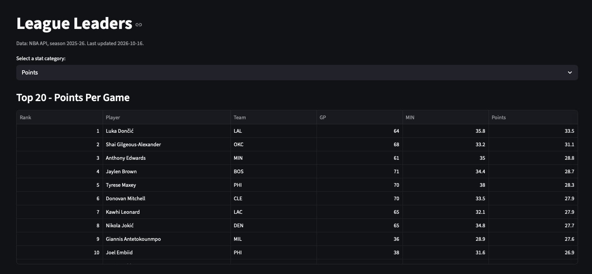

# NBA Stats Dashboard

Interactive NBA statistics dashboard built with Python and Streamlit.
Features league leaders, player comparison tools, and team analytics.
Data collected from the NBA API and refreshed periodically.

## Live Demo
[View the dashboard](https://davidalso-nba-dashboard.streamlit.app)



## Features
- **League Leaders** — Browse top players by points, assists, rebounds, steals, and blocks per game
- **Player Comparison** — Compare any two players head-to-head with a radar chart and stats breakdown
- **Team Stats** — View all 30 teams ranked by any stat category

## Tech Stack
- Python
- Streamlit
- Plotly
- pandas
- nba_api

## How It Works
1. `refresh_data.py` pulls per-game player and team stats from the NBA API and saves them as CSV files in `data/`, along with a last-updated date.
2. `data.py` loads those files with pandas and caches them using Streamlit's `@st.cache_data`.
3. Each page in `pages/` handles its own display: sorting and filtering with pandas, charts with Plotly, and layout with Streamlit.

## Design Decisions
- **Data snapshot instead of live API calls.** The first version called the NBA API directly, but the API blocked requests from the cloud host and the deployed app timed out. I separated data collection from display, so the app now reads saved data and stays fast and reliable.
- **Normalized radar chart.** The Player Comparison page scales each stat to a 0–1 range across the league so stats with different units (points vs. FG%) can share one chart.

## Project Structure
```
nba-dashboard/
├── app.py               # Landing page
├── data.py              # Loads and caches saved data
├── refresh_data.py      # Pulls fresh data from the NBA API
├── requirements.txt
├── data/                # players.csv, teams.csv, last_updated.txt
└── pages/
    ├── 1_League_Leaders.py
    ├── 2_Player_Comparison.py
    └── 3_Team_Stats.py
```

## Run Locally
```bash
git clone https://github.com/alsodavid/nba-dashboard.git
cd nba-dashboard
python3 -m venv venv
source venv/bin/activate
pip install -r requirements.txt
streamlit run app.py
```

To refresh the data (requires a connection that the NBA API accepts):
```bash
python refresh_data.py
```

## Known Limitations
- Data is a snapshot for the 2025-26 season, not live. The "last updated" date is shown on each page.
- Player radar chart scaling includes all players regardless of games played.

## Future Improvements
- Store the data in a SQL database instead of CSV files
- Add a minimum-games filter for the comparison chart
- Add trend charts and season-over-season comparisons
- Automate data refreshes on a schedule